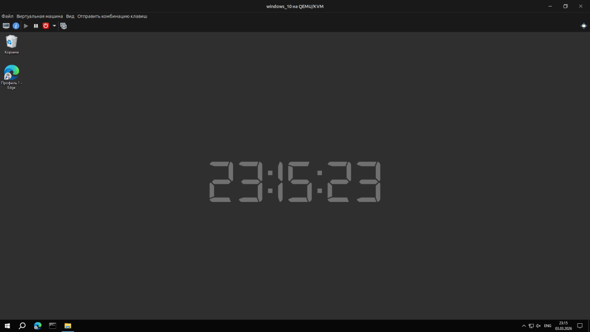

# Live Wallpaper Clock

Живые обои для Windows с цифровыми часами по центру экрана.

## Возможности

- Отображение текущего времени в реальном времени
- Центрирование по экрану
- Пользовательская конфигурация через `config.json`
- Минимальное потребление ресурсов

## Скриншот



## 🛠 Технологии

- Python 3.x
- PyQt6
- stypes
- Inno Setup (для сборки установщика)

## Установка

### Вариант 1 — готовый установщик
Скачать `.exe` из раздела Releases и установить.

### Вариант 2 — запуск из исходников

```bash
git clone https://github.com/yourname/live-wallpaper-clock.git
cd live-wallpaper-clock
python -m venv venv
source venv/bin/activate
pip install -r requirements.txt
python src/wallpaper.py
```